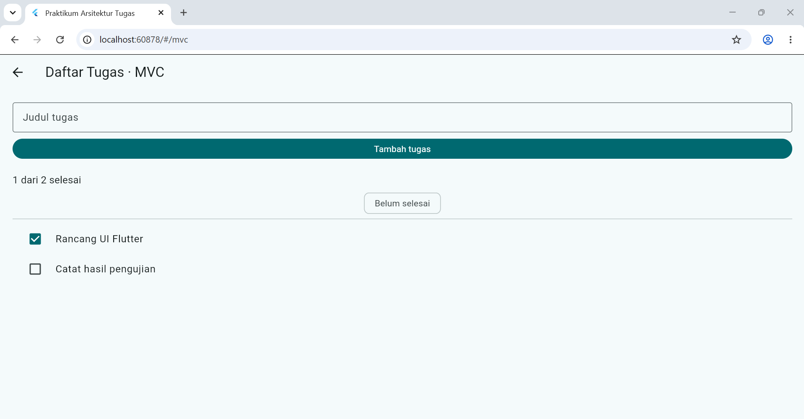
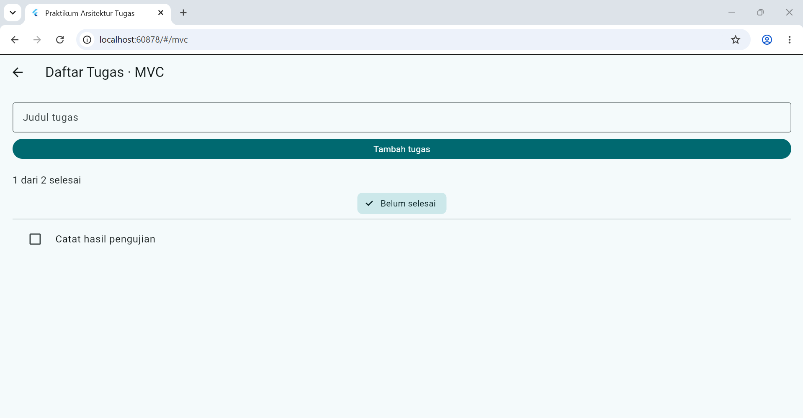
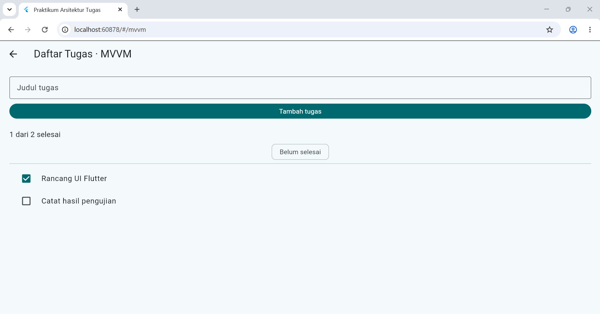
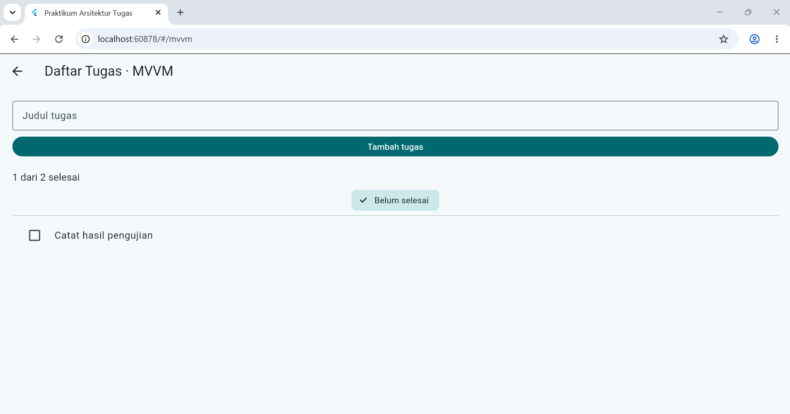

# LAPORAN PRAKTIKUM ARSITEKTUR TUGAS

## 1. Identitas Mahasiswa

- Nama: TITAH WAHYU DIAN LESTARI
- NIM: 362558302015
- Kelas: TRPL 2E
- Mata Kuliah: PEMROGRAMAN PERANGKAT BERGERAK

## 2. Cara Menjalankan Aplikasi

Aplikasi dibuat menggunakan Flutter dan dijalankan melalui Google Chrome.

Langkah menjalankan aplikasi:

1. Membuka folder proyek melalui Visual Studio Code.
2. Membuka terminal pada folder proyek.
3. Menjalankan perintah `flutter pub get`.
4. Menjalankan pengujian dengan perintah `flutter test`.
5. Menjalankan aplikasi menggunakan `flutter run -d chrome`.
6. Memilih implementasi MVC atau MVVM pada halaman awal aplikasi.

## 3. Implementasi MVC dan MVVM

### A. Model-View-Controller (MVC)

Pada implementasi MVC, program dibagi menjadi tiga bagian:

- Model: mengelola data tugas.
- View: menampilkan antarmuka aplikasi.
- Controller: menangani interaksi pengguna dan perubahan data.

Class yang digunakan antara lain `LayarMvc` dan `PengendaliTugas`.

Pembaruan tampilan dilakukan menggunakan `setState()` ketika terjadi perubahan data.

### B. Model-View-ViewModel (MVVM)

Pada implementasi MVVM, program dibagi menjadi tiga bagian:

- Model: mengelola data tugas.
- View: menampilkan antarmuka aplikasi.
- ViewModel: mengelola state dan logika yang berhubungan dengan tampilan.

Class yang digunakan adalah `LayarMvvm` dan `TugasViewModel`.

Pengelolaan perubahan tampilan menggunakan `ChangeNotifier` dan `notifyListeners()`.

## 4. Perbandingan MVC dan MVVM

| Aspek | MVC | MVVM |
|---|---|---|
| Pengelola interaksi | Controller | ViewModel |
| Pengelolaan state | State pada View | ViewModel |
| Pembaruan tampilan | setState() | notifyListeners() |
| Pemisahan logika | Melalui Controller | Melalui ViewModel |

Perbedaan utama kedua pendekatan terletak pada pengelolaan state dan cara memperbarui tampilan. Pada MVC, pembaruan dilakukan melalui `setState()`, sedangkan pada MVVM menggunakan `notifyListeners()`.

## 5. Hasil Pengujian

Pemeriksaan aplikasi dilakukan menggunakan perintah:

```bash
flutter analyze
flutter test
```

Hasil pemeriksaan terakhir:

- Flutter Analyze: No issues found.
- Flutter Test: All tests passed.
- Jumlah pengujian: 7 test berhasil.

Hasil tersebut menunjukkan bahwa kode berhasil melewati pemeriksaan analisis dan seluruh pengujian yang tersedia.

## 6. Dokumentasi Bukti Tampilan Aplikasi

Pengujian dilakukan menggunakan dua tugas yang sama, yaitu Rancang UI Flutter dan Catat hasil pengujian.

Tugas pertama ditandai selesai sehingga ringkasan menunjukkan 1 dari 2 selesai. Pengujian dilakukan dengan kondisi filter tidak aktif dan filter aktif.

### A. Implementasi MVC

**1. MVC dengan Filter Tidak Aktif**



**2. MVC dengan Filter Aktif**



### B. Implementasi MVVM

**3. MVVM dengan Filter Tidak Aktif**



**4. MVVM dengan Filter Aktif**



## 7. Percobaan Pembaruan Tampilan (Regresi)

Percobaan ini bertujuan untuk melihat pengaruh pemicu pembaruan tampilan pada masing-masing implementasi. Pengujian dilakukan dengan menghilangkan sementara pemicu pembaruan, kemudian mengembalikannya seperti semula.

### A. MVC

- Class: `LayarMvc`
- Metode: `_ubahStatus()`
- Pemicu pembaruan: `setState()`.

Hasil pengujian ketika `setState()` dihilangkan sementara:

[Diisi berdasarkan hasil pengujian aktual.]

Hasil setelah `setState()` dikembalikan:

[Diisi berdasarkan hasil pengujian aktual.]

### B. MVVM

- Class: `TugasViewModel`
- Metode: `ubahStatus()`
- Pemicu pembaruan: `notifyListeners()`.

Hasil pengujian ketika `notifyListeners()` dihilangkan sementara:

[Diisi berdasarkan hasil pengujian aktual.]

Hasil setelah `notifyListeners()` dikembalikan:

[Diisi berdasarkan hasil pengujian aktual.]

## 8. Kesimpulan

Melalui praktikum ini, saya dapat memahami penerapan arsitektur MVC dan MVVM pada aplikasi Flutter.

Kedua pendekatan dapat digunakan untuk membuat aplikasi daftar tugas dengan fitur yang sama. Perbedaannya terletak pada cara mengelola state dan memperbarui tampilan. MVC menggunakan Controller dan `setState()`, sedangkan MVVM menggunakan ViewModel dengan `ChangeNotifier` dan `notifyListeners()`.

Berdasarkan pemeriksaan terakhir, aplikasi berhasil melewati Flutter Analyze dan seluruh tujuh pengujian berhasil dijalankan.